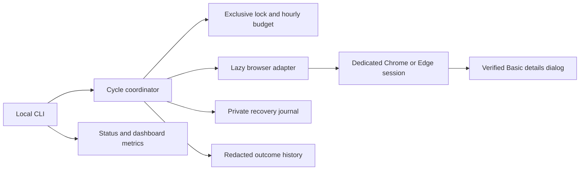

# System architecture

## Current implementation (Phases 1–2)

`src/cli.js` provides login, inspect, dry-run, save, recover and status. It checks activation, runs one attempt and optionally waits for one eligible retry. `src/cycle.js` owns journal phases, attempt reservation, recovery and finalization. `src/budget.js` enforces rolling 60-minute windows with at most two attempts. `src/browser.js` verifies the dialog, mutates only Name and checks fresh confirmation/persisted values. `src/history.js` provides flushed append-only events, ID deduplication and IST metrics. `src/errors.js` uses fixed non-sensitive reasons and explicit retryability.

## Sequence

Validate config and activation → acquire lock → recheck activation → validate history/journal/budget → reconcile interrupted reservations → enforce hourly budget → reserve attempt durably → lazily open dedicated browser → read verified persisted Name → journal original and temporary values → journal temporary-submit intent → change only Name and save → require fresh confirmation → reopen and verify temporary Name → persist milestone → journal restore intent → restore exact original and save → require fresh confirmation → reopen and verify original → persist restored journal → record completion if temporary milestone exists → close hourly window → remove pending journal → close browser.

Pending recovery takes priority over starting a new cycle, but cannot bypass budget. Observe persisted Name first; restore only the recorded temporary value. A different value blocks writes. A failed first transient attempt permits one retry at least 60 seconds after its persisted failure time. Interrupted/legacy failures get a durable detection timestamp. Security challenges, access denial/rate limits, validation errors and conflicts block that window without retry. Generic browser errors recheck security state; an uninspectable page blocks retry. There are no nested workflow retries. Unknown failures fail conservatively.

## Persistence and failure handling

The same exclusive lock guards all write attempts and interactive browser use. State/journal/budget use flushed temporary files and rename. History is flushed JSONL with stable event IDs. Completion is written before journal deletion so replay cannot inflate totals. A process crash consumes its reserved slot; the next invocation repairs missing interruption history. Corrupt files fail closed. These mechanisms cannot make two remote saves atomic or guarantee hardware-failure durability.

The CLI closes its browser before waiting and rechecks activation for the retry. Off prevents new attempts/retries; an in-progress reserved attempt may finish restoration. A crash can leave the lock; check its PID before manual removal. Never remove journal/budget to bypass limits. A temporary period can remain visible while restoration is unavailable or budget is exhausted.

## Boundaries and deployment

Live config accepts only HTTPS `www.naukri.com` profile URLs and installed `chrome`/`msedge` channels. Tests use intercepted mock routes, not production. This is not a network sandbox; normal login redirects may occur. Browser state is private local data protected by inherited Windows account permissions, not application encryption. No credentials, names or raw browser exceptions belong in history/status.

No database, cloud service, AI runtime or incoming server is used in Phase 2. Local Git excludes sessions and configuration. Each Windows machine needs installation and manual authentication; budgets are not synchronized between machines. Use one active machine per account.

Phase 3 validates actual Naukri controls and permission. Phase 4 replaces the prototype scheduler installer with sign-in/resume-aware hourly execution and adds a loopback dashboard On/Off control. The current installer is not activated. See [retry policy](RETRY-POLICY.md) and [dashboard requirements](DASHBOARD-AND-SCHEDULING.md).
