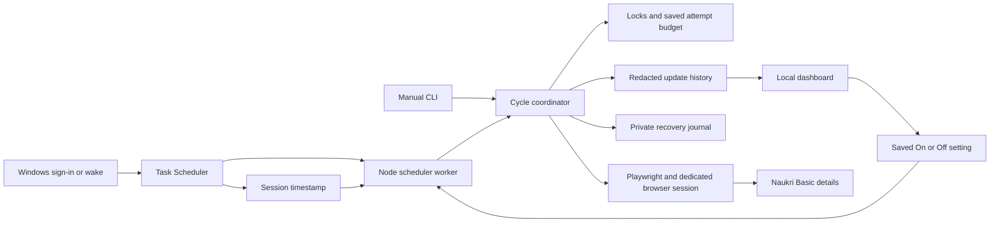

# System architecture

## What runs on Windows

| Component | Responsibility |
| --- | --- |
| `NaukriProfileScheduler` | Windows Task Scheduler starts the Node worker at sign-in, unlock or wake. A five-minute backup trigger starts it if it has stopped. Windows ignores overlapping worker starts. |
| `NaukriProfileScheduler-Session` | At sign-in or wake, this task runs a short Node script that records the event in `.local/windows-session.json` when the workflow is On. The script does not open Chrome. |
| `wscript.exe` and `scripts/run-scheduler-hidden.vbs` | Launch Node without flashing a command window. The Chrome mode is a separate application setting. |
| Windows account and NTFS permissions | The tasks run in your signed-in Windows session with limited privileges. The protected checkout restricts access to code, settings, and browser data. Chrome retains its scoped sandbox permissions. |
| Node.js and npm | Node runs the worker, dashboard, and CLI. npm installs Playwright and provides the project commands. |
| Installed Chrome or Edge | Playwright uses a dedicated browser profile under `.local/browser/`. Your normal browser profile is separate. |

The tasks leave the laptop asleep. After Windows sign-in or wake, the worker checks the saved signal and can start a fresh cycle when On. After a scheduled cycle starts, the app saves a randomly selected delay from 35 to 45 minutes at whole-second precision. The five-minute Windows timer only helps restart the worker. It does not set the profile-update interval.

`src/cli.js` provides login, inspection, dry-run, save, recovery and status. `src/scheduler.js` checks the switch, browser validation, session timestamp and saved eligibility. `src/cycle.js` manages attempt reservations, the recovery journal and final verification. `src/budget.js` tracks timing and at most one eligible retry per window. `src/browser.js` checks the origin and editor identity, updates the Name field, waits after each save and verifies the saved value. `src/history.js` stores redacted events and calculates IST metrics. The dashboard uses a local HTTP server on `127.0.0.1:4317` and can be closed independently of the worker.

## Sequence

Validate config and activation → acquire lock → recheck activation → validate history/journal/budget → reconcile interrupted reservations → enforce hourly budget → reserve attempt durably → lazily open dedicated browser → read verified persisted Name → journal original and temporary values → journal temporary-submit intent → change only Name and save → require fresh confirmation → reopen and verify temporary Name → persist milestone → journal restore intent → restore exact original and save → require fresh confirmation → reopen and verify original → persist restored journal → record completion if temporary milestone exists → close hourly window → remove pending journal → close browser.

Pending recovery takes priority over starting a new cycle, but cannot bypass budget. Observe persisted Name first; restore only the recorded temporary value. A different value blocks writes. A failed first transient attempt permits one retry at least 60 seconds after its persisted failure time. Interrupted/legacy failures get a durable detection timestamp. Security challenges, access denial/rate limits, validation errors and conflicts block that window without retry. Generic browser errors recheck security state; an uninspectable page blocks retry. There are no nested workflow retries. Unknown failures fail conservatively.

## Persistence and failure handling

The same exclusive lock guards all write attempts and interactive browser use. State/journal/budget use flushed temporary files and rename. History is flushed JSONL with stable event IDs. Completion is written before journal deletion so replay cannot inflate totals. A process crash consumes its reserved slot; the next invocation repairs missing interruption history. Corrupt files fail closed. These mechanisms cannot make two remote saves atomic or guarantee hardware-failure durability.

The CLI closes its browser before waiting and rechecks activation for the retry. Off prevents new attempts/retries; an in-progress reserved attempt may finish restoration. A crash can leave the lock; check its PID before manual removal. Never remove journal/budget to bypass limits. A temporary period can remain visible while restoration is unavailable or budget is exhausted.

## Boundaries and deployment

Live config accepts only HTTPS `www.naukri.com` profile URLs and installed `chrome`/`msedge` channels. Tests use intercepted mock routes, not production. This is not a network sandbox; normal login redirects may occur. Browser state is private local data protected by inherited Windows account permissions, not application encryption. No credentials, names or raw browser exceptions belong in history/status.

No database, cloud service, AI runtime or incoming server is used in Phase 2. Local Git excludes sessions and configuration. Each Windows machine needs installation and manual authentication; budgets are not synchronized between machines. Use one active machine per account.

Phase 3 tooling lives in `src/verification.js` and `src/verification-cli.js`: offline setup diagnostics, visible/headless dry-run evidence and one supervised fresh-cycle check. Evidence is redacted and tied to a configuration hash; the live verifier uses the existing coordinator and cannot bypass activation, recovery or budget. Actual Naukri controls and permission still require supervised validation.

Phase 4 adds `src/operation.js` for shared readiness, redacted dashboard status and Windows task probing; `src/dashboard.js` serves local assets and protected On/Off requests on 127.0.0.1. Activation writes use a separate control lock so Off can be saved while an attempt is in flight. `src/scheduler.js` wraps the existing coordinator with unattended validation and lock handling; its CLI polls every 15 seconds independently of the dashboard. Managed reservations recheck Windows task status. The installer defines hidden interactive-user sign-in/unlock/resume starts with an IgnoreNew watchdog, no wake, no catch-up and no task failure restart. Task installation and the Windows lifecycle pilot are not performed by local tests. See [operation](OPERATION.md), [supervised validation](SUPERVISED-VALIDATION.md) and [retry policy](RETRY-POLICY.md).
